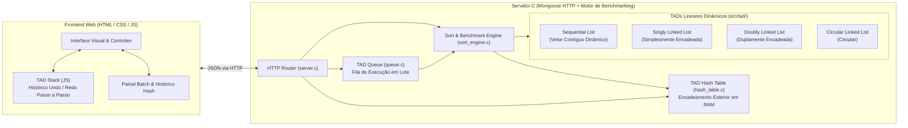

# AI Usage & Engineering Adaptation Log (`AI_LOG.md`)

This document records the chronological timeline of prompts, architectural pivots, AI-assisted implementations, and manual refactorings carried out during the development of **Ordena — Data Structures & Sorting Benchmark Platform** for the Data Structures course (`ARQESDD` — IFSP Araraquara).

> **Note on Prompt Language:** While this repository and documentation are standardized in English, all quoted prompts below are preserved verbatim in **Brazilian Portuguese (pt-BR)** exactly as they were originally written.

---

## 1. Chronological Development Timeline

### Stage 1 — Initial Project Conception & `PLAN.md` (C + WebAssembly + Vanilla JS)

The project started with the goal of building a browser-based sorting algorithm visualizer powered by a C engine compiled to WebAssembly (`.wasm`), combined with a Vanilla JavaScript frontend.

#### Prompt 1 — Initial Architecture & `PLAN.md` Generation
> *"me ajude a gerar um PLAN.md para estruturar a criação de um projeto que terá a interface visual escrita em javascript e o motor da aplicação em C, vai ser um projeto que permite o usuário a informar um array de numeros e comparar o funcionamento e performance de algoritmos de ordenação, o motor da aplicação vai ser escrito em C, mas acredito que fazer chamadas HTTP para essa aplicação C não é sustentável, uma vez que trocas e comparações precisam ser contabilizadas e mostradas ao usuário a medida em que estão acontecendo, vi uma abordagem utilizando .wasm que acredito que atenda a essa questão, a seguir segue um texto com alguns requisitos do projeto, não precisa levar tudo ao pé da letra, me pergunte para confirmar suas decisões, a idéia é criar uma plataforma no navegador que permite ao usuário visualizar os algoritmos em funcionamento e mostrar as métricas pro usuário, além dessa integração dos projetos, também serão implementadas as funcionalidades -> Projeto Testes de algoritmos de ordenação (...) Principais Recursos: Seleção de algoritmos como Bolha, Inserção, Seleção, Merge e Quick; Geração de dados aleatórios, invertidos ou ordenados; Painel de estatísticas com tempo exato, número de comparações e movimentações; Modo de passo a passo para avançar a execução do código. (...) Estrutura de Dados Sugerida: `Metricas` (`nome`, `comparacoes`, `trocas`, `tempo_ms`)."*

- **AI Output (`PLAN.md`)**:
  - Designed a 4-phase plan using **C compiled to WebAssembly via Emscripten** as the in-browser sorting engine and **Vanilla JS / HTML5 / CSS3** for rendering and playback.
  - Defined the core C structures (`TipoOperacao`: `COMPARA`, `TROCA`, `ESCRITA`; `Operacao`; and `Metricas` with `historico_operacoes` and `emscripten_get_now()`).
  - Structured implementation into: (1) Emscripten/Wasm setup & memory interop, (2) C engine & the 5 sorting algorithms, (3) Vanilla JS UI, and (4) `requestAnimationFrame` animation player with Play/Pause/Step controls.

<details>
<summary>Full AI-generated <code>PLAN.md</code> (Stage 1 — original pt-BR output)</summary>

# Plano de Desenvolvimento: Visualizador de Algoritmos de Ordenação (C + WebAssembly + Vanilla JS)

## 1. Visão Geral da Arquitetura
- **Motor (Backend no Navegador):** C compilado para WebAssembly (via Emscripten). Focado exclusivamente em processar arrays, ordenar, medir tempo e registrar os passos.
- **Interface (Frontend):** Vanilla JavaScript, HTML5 e CSS3. Responsável por manipular a DOM/Canvas para renderizar as barras, exibir métricas e controlar o player de animação.
- **Ponte (Interop):** O C exportará funções que o JS chamará enviando o array desordenado. O C retornará um ponteiro com as métricas e o "filme" (histórico) das operações.

## 2. Estrutura de Dados (Motor em C)

```c
#include <emscripten.h>

typedef enum { COMPARA, TROCA, ESCRITA } TipoOperacao;

typedef struct {
    TipoOperacao tipo;
    int indice1;
    int indice2;
    int valor1; 
    int valor2;
} Operacao;

typedef struct {
    char nome[30];
    long long comparacoes;
    long long trocas;
    double tempo_ms; // Calculado usando emscripten_get_now()
    Operacao* historico_operacoes;
    int total_operacoes;
} Metricas;
```

## 3. Fases de Implementação

### Fase 1: Setup e Integração Wasm (Fundação)
- [ ] Configurar ambiente Emscripten.
- [ ] Criar Makefile para compilar o C para `.wasm` e `.js` de ligação.
- [ ] Implementar a alocação e passagem de arrays do Vanilla JS para o Wasm.
- [ ] Definir a leitura de memória no JS para extrair a struct `Metricas` e o array `historico_operacoes` gerados pelo C.

### Fase 2: O Motor em C (Lógica e Algoritmos)
- [ ] Implementar o gerador de vetores em C (Aleatório, Crescente, Decrescente).
- [ ] Implementar as funções de contagem de tempo em volta de cada algoritmo usando `emscripten_get_now()`.
- [ ] Implementar Bubble Sort e Selection Sort populando o log de `Operacao`.
- [ ] Implementar Insertion Sort mapeando deslocamentos como `ESCRITA`.
- [ ] Implementar Quick Sort e Merge Sort.

### Fase 3: Interface Visual (Vanilla JS e DOM)
- [ ] Estruturar o `index.html` com seletores nativos (`<select>`, `<button>`) e painel lateral de resultados.
- [ ] Criar a lógica de renderização usando manipulação de `<div>`s via DOM ou HTML5 `<canvas>` para as barras do array.
- [ ] Conectar os botões do HTML para disparar a geração do vetor e o início da ordenação no Wasm.

### Fase 4: O Player de Animação e Métricas
- [ ] Criar o loop de animação no JS usando `requestAnimationFrame`.
- [ ] Fazer o loop iterar sobre o `historico_operacoes` para alterar as cores e posições das barras na tela.
- [ ] Implementar o controle de estado da animação: Play, Pause, Avançar Passo, Voltar Passo.
- [ ] Atualizar o HTML interno (`innerHTML` ou `textContent`) com os dados reais devolvidos na struct `Metricas`.

</details>

- **Execution & Initial Fixes**:
  - A fresh chat session (without prior context) was opened to implement the generated `PLAN.md`.
  - After the initial implementation, a series of short conversations were used to fix minor early bugs and adjust algorithm behavior.

---

### Stage 2 — Architectural Pivot: From WebAssembly to a C REST API

To simplify the architecture and integrate course-style Abstract Data Types (ADTs) directly into the C backend, WebAssembly was replaced by a C HTTP REST API built with **Mongoose**, returning the full operation history as JSON for the web client to animate.

#### Prompt 2 — Switching from WebAssembly to Mongoose REST API + Dynamic Sequential List
> *"Vamos alterar a forma como esse projeto vai funcionar, iremos esquecer o WebAssembly, agora a aplicaçao em C vai funcionar como uma API que vai receber as requisicoes GET e devolver a resposta com todo o historico de operacoes para o cliente, cliente esse que ira ser responsavel por ler a resposta e formatar ela na interface para o usuario, acredito que de forma semelhante o codigo em web assembly faz isso. Utilizaremos um tipo abstrato de dados para lidar com a montagem do json do historico de ordenacao, uma lista sequencial dinamica (deixarei no codigo os arquivos base dessa lista que deverao ser adaptados para o nosso codigo). do lado do C, vai ser utilizada a biblioteca Moongose para servir como o servidor de rede, alem disso acredito que o codigo C vai ter que ser adaptado para essa mudança, mantenha a base dos algoritmos como estao e adicione o que precisa. pode remover a logica relacionada a webassembly e seu consumo no projeto"*

- **Outcome & Adaptations**:
  - Removed all WebAssembly / Emscripten build artifacts and JavaScript interop code.
  - Added the **Mongoose** HTTP server in `src/server.c` to serve `GET /api/sort` requests and return the complete sorting operation trace in JSON format.
  - Adapted the course-provided sequential list base files (`listaSequencial`) into a dynamic sequential list ADT to collect and serialize the sorting operation history, establishing the first working REST API version of the project.

---

### Stage 3 — New Course Requirements & Full Data Structures Architecture (`plan.md`)

When the final assessment specification PDF introduced additional mandatory criteria (dynamic memory allocation with memory tracking, Singly/Doubly/Circular Linked Lists with pointer manipulation, Stack for step-by-step Undo, Queue for batch processing, Separate-Chaining Hash Table for test history, and full English standardization), the PDF and the discipline's reference ADT files (`lista.h`/`lista.c` and `tabela_hash.c`) were provided as context.

#### Prompt 3 — Gap Analysis & Full Architecture Planning (`plan.md`)
> *"note que o projeto atualmente está em progresso, já temos progresso referente ao que está sendo pedido, atualmente utilizamos uma lista sequencial para montar o array de comparações de cada algoritmo de ordenação, porém precisamos adaptar para atender todos os critérios. minha idéia é criar um plan.md depois dessa análise para iniciarmos a implementação.*
>
> *sobre pilhas, entendo que teremos que criar a estrutura de dado do lado do javascript, uma vez que esse controle de operações é feito por lá, a fila para o batch processing deverá ser feita do lado do C*
>
> *tabela hash será feita do lado do C e essa funcionalidade para recuperar testes anteriores ainda não existe, deveremos salvar todos os testes e seu histórico*
>
> *leve em consideração o pdf de contexto e minhas falas para análise do projeto e me retorne um plan.md para as alterações.*
>
> *as estruturas de dados enviadas servirao como base para o padrão de TADs que busco, mas lembre-se que deverão ser dinamicas, entao utilize malloc, realloc e free para manipular esses dados*
>
> *me pergunte se surgirem duvidas no meio do caminho"*

- **AI Output (`plan.md`)**:
  - Produced a full Gap Analysis comparing the existing REST prototype against every course criterion.
  - Specified the 5-phase engineering plan covering dynamic allocation (`malloc`/`realloc`/`free`), memory usage instrumentation (`memory_bytes`), English standardization, new REST endpoints (`/api/batch`, `/api/history`, `/api/history/detail`), and the exact ADT designs.

<details>
<summary>Full AI-generated <code>plan.md</code> (Stage 3 — original pt-BR output)</summary>

# Plano de Arquitetura e Implementação — Plataforma de Análise de Estruturas e Algoritmos (Ordena)

Este documento detalha o diagnóstico do estado atual do projeto e o plano completo de engenharia para atender a todos os requisitos da Avaliação Final descritos no PDF da disciplina, incorporando suas definições de arquitetura.

---

## 1. Diagnóstico do Estado Atual vs. Requisitos do Projeto

| Requisito (PDF + Definições) | Estado Atual no Repositório | O que precisa ser feito (Gap Analysis) |
| :--- | :--- | :--- |
| **Alocação Dinâmica e Ponteiros** (`malloc`, `realloc`, `free`) + Monitoramento de Tempo e Memória | `src/sort_engine.c` ainda usa vetores estáticos globais (`values[MAX_ITEMS]`, `merge_buffer[MAX_ITEMS]`) e `src/server.c` usa `values[API_MAX_INPUT]`. `Metrics` monitora apenas tempo, comparações e trocas (sem consumo de memória). | Substituir todos os buffers estáticos por alocação 100% dinâmica (`malloc`/`realloc`/`free`), unificar o histórico de operações com o TAD de Lista Sequencial e instrumentar o cálculo de memória alocada (`memoryBytes` / pico e consumo da estrutura + auxiliar). |
| **Listas Lineares (Simplesmente Encadeada, Duplamente Encadeada e Circular)** | Existe apenas `listaSequencial` em `src/tad/`, usada apenas na serialização do JSON em `server.c`. Os 5 algoritmos ordenam apenas o array estático `values[]`. | Criar os TADs dinâmicos para **Singly Linked List**, **Doubly Linked List** e **Circular Linked List** seguindo o padrão de tipos opacos (`typedef struct ...`) do código base enviado. Implementar os 5 algoritmos (Bubble, Selection, Insertion, Quick, Merge) manipulando ponteiros/nós em cada estrutura para comparar o desempenho com o vetor contíguo dinâmico (`Sequential List`). |
| **Pilha (Undo / Passo a Passo no JS)** | `web/app.js` usa um array simples de `animationFrames` indexado por `currentFrameIndex`. | Implementar a estrutura de dados **Stack (Pilha)** no JavaScript (`UndoStack` / `RedoStack`) para gerenciar o histórico de operações no modo passo a passo (*Step Back / Undo* e *Step Forward / Redo*) sobre o estado visualizado. |
| **Fila (Batch Processing no C)** | Não existe execução em lote. A API possui apenas `GET /api/sort` para uma única execução. | Criar o TAD dinâmico **Queue (Fila)** em C (`malloc`/`free` com nós encadeados) para enfileirar múltiplos cenários de teste (diferentes estruturas, tamanhos e algoritmos) e processá-los em lote via novo endpoint (`POST /api/batch` ou `GET /api/batch`), retornando o relatório comparativo de desempenho. |
| **Tabela Hash (Extra — Histórico em C)** | Não existe armazenamento de testes anteriores; cada chamada a `sort_run` sobrescreve e libera os dados ao final da requisição. | Criar o TAD dinâmico **Hash Table** em C com **encadeamento exterior** (*Separate Chaining*: array dinâmico de buckets alocado com `malloc`/`realloc` apontando para listas encadeadas dinâmicas) indexado pelo nome do algoritmo (`algorithmName`), mantendo em memória (RAM) todos os testes executados e seus históricos completos para consulta rápida. |
| **Padronização em Inglês + `AI_LOG.md`** | Código misto: `sort_engine.c` em inglês, `listaSequencial.c`, `server.c` (mensagens), `index.html` e `README.md` em português. `AI_LOG.md` ainda não existe. | Padronizar 100% dos identificadores (incluindo TADs), comentários de código e `README.md` em inglês. Criar e manter o arquivo `AI_LOG.md` documentando prompts e adaptações. |

---

## 2. Arquitetura do Sistema e Organização de Diretórios



### Estrutura de Arquivos Proposta (`src/`)

Seguindo o padrão de separação entre `headerFiles` e `sourceFiles` já presente em `src/tad/` e totalmente padronizado em inglês:

```text
src/
├── server.c                              # Servidor HTTP Mongoose e rotas REST JSON
├── sort_engine.h                         # Interface pública do motor de ordenação e métricas
├── sort_engine.c                         # Implementação dos 5 algoritmos para Vetor e Listas + métricas de memória/tempo
└── tad/
    ├── headerFiles/
    │   ├── sequential_list.h             # (Antigo listaSequencial.h) Vetor dinâmico com malloc/realloc/free
    │   ├── singly_linked_list.h          # Lista Simplesmente Encadeada dinâmica (baseada no lista.h enviado)
    │   ├── doubly_linked_list.h          # Lista Duplamente Encadeada dinâmica
    │   ├── circular_linked_list.h        # Lista Circular dinâmica
    │   ├── queue.h                       # Fila dinâmica para Batch Processing de testes
    │   └── hash_table.h                  # Tabela Hash dinâmica (Encadeamento Exterior) para histórico de testes
    └── sourceFiles/
        ├── sequential_list.c
        ├── singly_linked_list.c
        ├── doubly_linked_list.c
        ├── circular_linked_list.c
        ├── queue.c
        └── hash_table.c
```

---

## 3. Especificação Detalhada dos TADs (Padrão da Disciplina + Alocação Dinâmica)

Todos os TADs seguirão o estilo dos arquivos base enviados (`lista.h`/`lista.c` e `tabela_hash.c`): structs encapsuladas no `.c` com `typedef struct ...` no `.h` (tipos opacos), verificação rigorosa de `NULL` e uso explícito de `malloc`, `realloc` e `free`.

### 3.1. `sequential_list` (Vetor Contíguo Dinâmico)
- Refatoração de `listaSequencial.c` / `.h` para inglês (`SequentialList`).
- Mantém `void *elements`, `int size`, `int capacity`, `size_t element_size`.
- Funções: `seq_list_create`, `seq_list_insert_end`, `seq_list_insert_start`, `seq_list_remove_at`, `seq_list_get`, `seq_list_set`, `seq_list_size`, `seq_list_memory_usage`, `seq_list_destroy`.
- Usado tanto como estrutura de dados contígua a ser ordenada quanto para armazenar o array dinâmico de `Operation` durante a execução do algoritmo.

### 3.2. `singly_linked_list`, `doubly_linked_list` e `circular_linked_list`
- Baseados diretamente na estrutura `No` / `Lista` de `lista.c` enviada:
  - **Singly Linked List**: `SinglyNode { int32_t data; struct SinglyNode *next; }`, com controle de `head`, `tail`, `size` e `memory_bytes`.
  - **Doubly Linked List**: `DoublyNode { int32_t data; struct DoublyNode *prev; struct DoublyNode *next; }`, com `head`, `tail`, `size` e `memory_bytes`.
  - **Circular Linked List**: `CircularNode { int32_t data; struct CircularNode *next; }`, onde `tail->next == head`, com `head`, `tail`, `size` e `memory_bytes`.
- **Ordenação por manipulação de ponteiros**:
  - Os 5 algoritmos (`Bubble Sort`, `Selection Sort`, `Insertion Sort`, `Quick Sort`, `Merge Sort`) serão implementados operando sobre os nós das listas e reencadeando ponteiros (`next`/`prev`) — especialmente no *Insertion Sort* (remoção e reinserção de nó na sublista ordenada por ponteiros) e *Merge Sort* (divisão por ponteiro *slow/fast* e fusão religando ponteiros sem vetor auxiliar), emitindo os eventos `Operation` correspondentes para que o visualizador também possa animar e comparar com o vetor contíguo.

### 3.3. `queue` (Fila Dinâmica em C para Batch Processing)
- Implementada com alocação dinâmica encadeada (`QueueNode` com `malloc`/`free`, ponteiros `front` e `rear`, contador `size`).
- Cada item da fila (`BatchTask`) armazena:
  - `int algorithm` (0..4)
  - `int structure_type` (`STRUCT_SEQUENTIAL`, `STRUCT_SINGLY`, `STRUCT_DOUBLY`, `STRUCT_CIRCULAR`)
  - `int32_t *input_values` (alocado dinamicamente com `malloc`)
  - `int item_count`
- Operações do TAD:
  - `Queue *queue_create(void)`
  - `int queue_enqueue(Queue *queue, const BatchTask *task)`
  - `int queue_dequeue(Queue *queue, BatchTask *out_task)`
  - `int queue_is_empty(const Queue *queue)`
  - `int queue_size(const Queue *queue)`
  - `void queue_destroy(Queue *queue)`

### 3.4. `hash_table` (Tabela Hash Dinâmica com Encadeamento Exterior em C)
- Segue a organização modular de `tabela_hash.c` combinada com a lista encadeada dinâmica de `lista.c`:
  - A estrutura `HashTable` possui um vetor dinâmico de ponteiros de buckets (`HashNode **buckets`) alocado via `malloc` e redimensionável via `realloc` (`hash_table_resize` quando o fator de carga $\alpha = \text{count} / M > 0.75$).
  - Função de espalhamento (*hash function*) sobre string (`const char *algorithm_name`), ex.: polinomial / DJB2 módulo `M` (`index = hash_function(key) % table->bucket_count`), mantendo também compatibilidade conceitual com o operador `% M`.
  - **Tratamento de colisões por Encadeamento Exterior (Separate Chaining)**: cada posição `buckets[index]` aponta para uma lista encadeada de `HashNode`.
  - Cada `HashNode` armazena um `TestReport` alocado dinamicamente:
    - `uint64_t test_id` (identificador único sequencial)
    - `char *algorithm_name` (chave indexada, ex.: `"Bubble Sort"`, `"Merge Sort"`)
    - `int algorithm_id` e `int structure_type` (`Sequential`, `Singly`, `Doubly`, `Circular`)
    - `Metrics metrics` (incluindo `comparisons`, `swaps`, `elapsed_ms`, `memory_bytes`, `operation_count`)
    - `int32_t *input_values` e `int32_t *sorted_values` (alocados dinamicamente)
    - `Operation *operations` (ou `SequentialList *operations` com o histórico completo de passos daquele teste)
- Operações do TAD:
  - `HashTable *hash_table_create(size_t initial_bucket_count)`
  - `int hash_table_insert(HashTable *table, const char *algorithm_name, const TestReport *report)`
  - `SequentialList *hash_table_search_by_algorithm(HashTable *table, const char *algorithm_name)` (recupera todos os relatórios daquele algoritmo percorrendo a lista encadeada do bucket correspondente)
  - `const TestReport *hash_table_get_by_id(HashTable *table, uint64_t test_id)` (recupera um teste específico com seu array completo de `operations` para re-reproduzir na tela)
  - `void hash_table_destroy(HashTable *table)` (libera todos os arrays internos, nós encadeados, vetores de buckets e a estrutura principal com `free`)

### 3.5. `OperationStack` (Pilha Dinâmica no JavaScript para Undo / Passo a Passo)
- No arquivo `web/app.js`, criação da classe/TAD `Stack`:
  - Métodos clássicos de TAD: `push(element)`, `pop()`, `peek()`, `isEmpty()`, `size()`, `clear()`.
- **Integração com o modo passo a passo**:
  - Duas instâncias: `undoStack` (pilha de operações aplicadas) e `redoStack` (pilha de operações desfeitas).
  - Em vez de depender apenas de snapshots pré-copiados de todo o vetor em cada passo, cada operação executada (`COMPARE`, `SWAP`, `WRITE`) empilha na `undoStack` um registro reversível contendo os valores anteriores (`prevFirstValue`, `prevSecondValue`, métricas anteriores).
  - Quando o usuário clica em **Voltar um passo (Undo / `‹`)**, o sistema faz `undoStack.pop()`, reverte cirurgicamente a alteração no array `displayedValues`, restaura as métricas daquele ponto e empilha a operação em `redoStack`.
  - Quando avança um passo (`›`), desempilha de `redoStack` (ou consome a próxima operação) e empilha em `undoStack`.

---

## 4. Novas Métricas e Endpoints da API HTTP (`src/server.c`)

### 4.1. Monitoramento de Tempo e Memória (`Metrics`)
A struct `Metrics` em `src/sort_engine.h` será expandida para:
```c
typedef struct {
  int32_t algorithm;
  int32_t structure_type;
  int32_t item_count;
  int64_t comparisons;
  int64_t swaps;
  double elapsed_ms;
  size_t memory_bytes;      /* Memória dinâmica alocada pela estrutura + buffers auxiliares */
  int32_t operation_count;
} Metrics;
```
- **Cálculo de Memória (`memory_bytes`)**:
  - **Sequential List (Vetor Dinâmico)**: `sizeof(SequentialList) + capacity * sizeof(int32_t)` (+ buffer auxiliar dinâmico no Merge Sort).
  - **Singly Linked List**: `sizeof(SinglyLinkedList) + item_count * sizeof(SinglyNode)`.
  - **Doubly Linked List**: `sizeof(DoublyLinkedList) + item_count * sizeof(DoublyNode)`.
  - **Circular Linked List**: `sizeof(CircularLinkedList) + item_count * sizeof(CircularNode)`.
  - Isso permitirá visualizar claramente na interface a diferença de overhead de memória entre vetores contíguos e listas encadeadas (ponteiros extras por nó vs. realocação de capacidade).

### 4.2. Rotas HTTP (JSON)
1. **`GET /api/sort?algorithm=<0..4>&structure=<0..3>&values=<csv>`**
   - Executa a ordenação na estrutura escolhida (`0` Sequential Array, `1` Singly Linked List, `2` Doubly Linked List, `3` Circular Linked List).
   - Salva automaticamente o relatório completo e seu histórico na **Tabela Hash** em memória.
   - Retorna o JSON com `testId`, `algorithm`, `algorithmName`, `structure`, `structureName`, `input`, `sorted`, `metrics` (incluindo `memoryBytes`) e `operations`.
2. **`POST /api/batch` (ou `GET /api/batch?algorithms=...&structures=...&values=...`)**
   - Recebe uma lista de tarefas de teste, insere cada uma na **Fila (`Queue`)** em C, consome a fila até esvaziar (`queue_dequeue`) executando cada benchmark, registra todos os resultados na **Tabela Hash** e retorna um JSON comparativo com as métricas de todas as execuções do lote.
3. **`GET /api/history?algorithm=<algorithmName>`**
   - Consulta a **Tabela Hash** em C pelo nome do algoritmo (ou lista todos se omitido), retornando os relatórios de testes anteriores indexados na tabela (com `testId`, estrutura utilizada, tamanho da entrada, comparações, trocas, tempo em ms e memória em bytes).
4. **`GET /api/history/detail?id=<testId>`**
   - Recupera da **Tabela Hash** o histórico completo (`operations`, `input`, `sorted`, `metrics`) de um teste anterior específico para recarregá-lo e animá-lo novamente na interface web.

---

## 5. Evoluções na Interface Web (`index.html`, `web/app.js`, `web/style.css`)

1. **Seletor de Estrutura de Dados**:
   - Adicionar ao painel lateral (`aside.controls`) a seleção da estrutura linear:
     - `Dynamic Contiguous Array (Sequential List)`
     - `Singly Linked List`
     - `Doubly Linked List`
     - `Circular Linked List`
2. **Card de Métrica de Consumo de Memória**:
   - Adicionar nos cards de métricas (`div.metrics`) o indicador **MEMORY USAGE** (em `bytes` / `KB`), exibindo o consumo dinâmico reportado pelo C.
3. **Controle Passo a Passo com Pilha (Undo/Redo)**:
   - Refatorar o player em `web/app.js` para operar sobre o TAD `Stack` em JavaScript, exibindo o topo da pilha e o tamanho da pilha de Undo/Redo no rótulo de passo.
4. **Seção de Execução em Lote (Batch Processing — Fila) e Histórico (Tabela Hash)**:
   - Adicionar abaixo do gráfico principal (ou em abas/painéis inferiores):
     - **Batch Benchmark (Queue)**: botão para enfileirar e comparar os algoritmos/estruturas (ex.: comparar Vetor vs. Listas Encadeadas para a mesma entrada) exibindo uma tabela comparativa de Tempo, Comparações, Trocas/Ponteiros e Memória.
     - **Previous Tests History (Hash Table Lookup)**: filtro de busca pelo nome do algoritmo que consulta `/api/history?algorithm=...` na Tabela Hash em C, lista os testes passados e permite clicar em **"Replay"** para carregar aquele teste de volta no visualizador.

---

## 6. Fases de Execução Passo a Passo

### Fase 1: Refatoração e Criação dos TADs Lineares Dinâmicos em C (`src/tad/`)
1. Renomear e padronizar `listaSequencial` para `sequential_list.h` / `sequential_list.c` em inglês.
2. Implementar `singly_linked_list.h/.c`, `doubly_linked_list.h/.c` e `circular_linked_list.h/.c` usando `malloc`/`free` e tipos opacos.
3. Implementar os 5 algoritmos de ordenação manipulando nós/ponteiros para as 3 listas encadeadas e para a lista sequencial dinâmica.

### Fase 2: TADs de Fila (Batch) e Tabela Hash (Encadeamento Exterior) em C (`src/tad/`)
1. Implementar `queue.h/.c` com alocação dinâmica para armazenar e processar lotes de `BatchTask`.
2. Implementar `hash_table.h/.c` com vetor dinâmico de buckets (`malloc`/`realloc`) e listas encadeadas para colisões (encadeamento exterior), indexando relatórios de teste (`TestReport`) pelo nome do algoritmo.

### Fase 3: Motor de Ordenação e Rotas do Servidor (`src/sort_engine.*`, `src/server.c`)
1. Remover todos os arrays estáticos (`values[MAX_ITEMS]`, `merge_buffer[MAX_ITEMS]`, `values[API_MAX_INPUT]`) substituindo por alocação dinâmica (`malloc`/`realloc`/`free`).
2. Adicionar rastreamento preciso de `memory_bytes` em `Metrics`.
3. Integrar `HashTable` global no ciclo de vida do servidor (`server.c`) para salvar automaticamente cada execução e expor `/api/history` e `/api/history/detail`.
4. Integrar `Queue` na nova rota `/api/batch`.

### Fase 4: Frontend Web + Pilha de Undo em JavaScript (`index.html`, `web/app.js`, `web/style.css`)
1. Implementar a classe TAD `Stack` em `web/app.js` e conectá-la aos controles de passo a passo (`Undo` / `Redo`) e timeline.
2. Atualizar a UI com seletor de Estrutura Linear, métrica de Memória, painel de Batch Processing (Fila) e painel de Histórico de Testes (busca na Tabela Hash com Replay).
3. Padronizar textos/comentários e código em inglês.

### Fase 5: Documentação Final e Integridade Acadêmica (`README.md`, `AI_LOG.md`)
1. Reescrever o `README.md` em inglês documentando a arquitetura, estruturas de dados, complexidades, endpoints da API e instruções de build/execução.
2. Criar o arquivo `AI_LOG.md` registrando os prompts utilizados e explicando as adaptações para os padrões de TADs da disciplina.
3. Compilar com `make rebuild` (`-Wall -Wextra`) garantindo zero warnings e testar todas as funcionalidades.

</details>

- **Execution & Adaptations to Course ADT Standards**:
  - A new chat session was started to implement `plan.md`, producing the complete data-structures platform with the following key adaptations:
  1. **Opaque Linear ADTs (`src/tad/`)**: Refactored `listaSequencial` to `sequential_list` and implemented `singly_linked_list`, `doubly_linked_list`, and `circular_linked_list` following the discipline's opaque-type pattern (`typedef struct ...` in headers under `src/tad/headerFiles/`, internal structs encapsulated in `.c` files under `src/tad/sourceFiles/`).
  2. **Pointer-Based Sorting & Observer Callbacks (`list_sort_observer.h`)**: Implemented all 5 algorithms (Bubble, Selection, Insertion, Quick, Merge) operating on linked list nodes by relinking `next`/`prev` pointers (including backwards traversal via `prev` in Doubly Linked List Insertion Sort and in-place pointer merging in Merge Sort without an auxiliary array), using lightweight observer callbacks (`on_compare`, `on_swap`, `on_write`) to emit visualization events without breaking ADT encapsulation.
  3. **Dynamic Queue ADT (`queue.h/.c`)**: Built a linked-node dynamic queue (`front`/`rear` pointers, `malloc`/`free`) in C to enqueue and execute batch benchmark tasks via `/api/batch`.
  4. **Dynamic Separate-Chaining Hash Table ADT (`hash_table.h/.c`)**: Adapted the discipline's modular hash table pattern (`tabela_hash.c`) into a 100% dynamic Separate-Chaining Hash Table indexed by `algorithmName`, using a dynamically allocated bucket array (`HashNode **buckets`) resized via `realloc` when load factor $\alpha = \text{count} / M > 0.75$ and linked lists (`HashNode *next`) to chain collisions and multiple test runs.
  5. **Frontend Stack ADT (`OperationStack` in `web/app.js`)**: Replaced flat frame-array indexing with two linked-node stacks (`undoStack` and `redoStack`) storing reversible step records (`prevFirstValue`, `prevSecondValue`, previous metrics) for Step Back (Undo) and Step Forward (Redo) playback.

---

### Stage 4 — Post-Implementation Bug Fixes & Manual Refactoring

- **Bug Fixes**: Following the implementation of `plan.md`, a series of short conversations were used to fix minor runtime and edge-case bugs.
- **Manual Refactoring**: Several parts of the codebase were manually refactored to improve modularity, readability, and separation of concerns, including:
  - Extracting responsibilities out of `src/server.c` into dedicated utility modules under `src/utils/` (`batch_runner`, `history_store`, `http_response`, `input_parser`, `json_builder`, and `json_serializer`).
  - Refining internal implementations across `src/server.c`, `src/tad/sourceFiles/hash_table.c`, `src/tad/sourceFiles/queue.c`, `src/tad/sourceFiles/sequential_list.c`, and `web/app.js`.

---

## 2. Verification & Quality Assurance
- Compiled with `gcc -O2 -std=c11 -D_GNU_SOURCE -Wall -Wextra` via `make rebuild` with **zero warnings**.
- Verified all 20 combinations of `(5 algorithms × 4 linear data structures)` for sorting correctness, operation trace accuracy, batch queue execution, hash table history lookup/replay, and dynamic memory cleanup (`free`).
