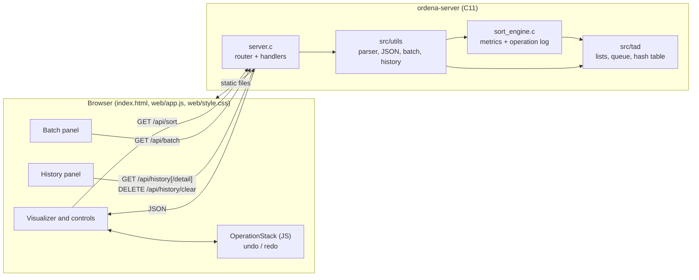
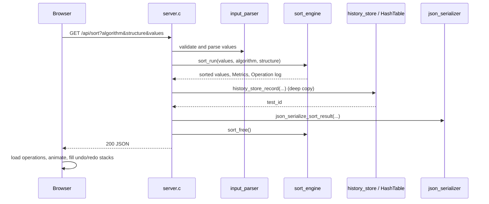
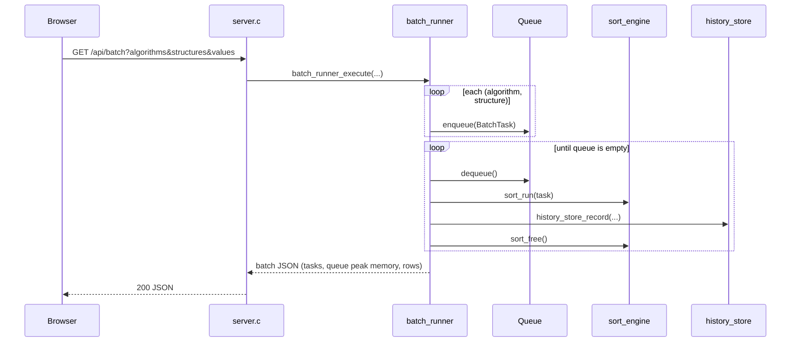

# Ordena — System Architecture

This document describes how **Ordena** is organized internally: its layers, modules, data flow and the main design decisions. For *what* the system must do, see [REQUIREMENTS.md](REQUIREMENTS.md).

---

## 1. Overview

Ordena is a client–server application packaged as a single native binary.

- **Backend (C11):** an embedded [Mongoose](https://github.com/cesanta/mongoose) HTTP server, a sorting and benchmarking engine, and a set of hand-written Abstract Data Types (ADTs).
- **Frontend (HTML/CSS/JavaScript):** a static page served by the same binary. It calls a JSON REST API and animates the returned operation log.



## 2. Layered Design

Dependencies flow primarily downward from presentation to ADTs. As a pragmatic exception for domain-typed storage, `hash_table` (in `src/tad/`) references `Metrics` and `Operation` from `sort_engine.h` to store full `TestReport` snapshots, while `list_sort_observer.h` exposes the shared `SortAlgorithm` enum downward to all list sorting implementations.

| Layer | Location | Responsibility |
| :--- | :--- | :--- |
| **Presentation** | `index.html`, `web/` | Controls, bar chart, playback, undo/redo stack, batch and history tables. |
| **HTTP / API** | `src/server.c`, `src/utils/*/http_response.*` | Routing, method checks, parameter reading, status codes, static file serving. |
| **Application helpers** | `src/utils/` | Input parsing and validation, JSON building, batch orchestration, history facade. |
| **Domain engine** | `src/sort_engine.c` | Runs one sort on one structure, measures time and memory, records the operation log. |
| **Data structures (ADTs)** | `src/tad/` | Sequential list, singly/doubly/circular linked lists (each with the 5 sorts), queue, hash table. |
| **Third party** | `vendor/mongoose.*` | HTTP server library (not modified by the team). |

## 3. Repository Layout

```text
.
├── index.html                 Web UI page
├── Makefile                   Cross-platform build (Linux, macOS, Windows)
├── README.md                  User documentation
├── REQUIREMENTS.md            Requirements specification
├── ARCHITECTURE.md            This document
├── AI_LOG.md                  AI prompts and how they were adapted
├── plan.md                    Original planning notes (Portuguese)
├── web/
│   ├── app.js                 Frontend controller + OperationStack ADT
│   └── style.css              Styling
├── vendor/                    Mongoose (header + source)
└── src/
    ├── main.c                 Entry point, starts the server
    ├── server.h / server.c    HTTP router and endpoint handlers
    ├── sort_engine.h / .c     Sort execution, metrics, operation log
    ├── tad/
    │   ├── headerFiles/       Public ADT interfaces (opaque types)
    │   └── sourceFiles/       ADT implementations
    └── utils/
        ├── headerFiles/       Helper interfaces
        └── sourceFiles/       Helper implementations
```

## 4. Module Reference

### 4.1 ADTs (`src/tad/`)

All ADTs are **opaque**: the header declares `typedef struct name Name;` and the `struct` body lives only in the `.c` file.

| Module | Type | Internal structure | Role in the system |
| :--- | :--- | :--- | :--- |
| `sequential_list` | `SequentialList` | Contiguous heap block (`malloc`, grown with `realloc`), generic by `element_size`. | Contiguous structure to be sorted; also stores the `Operation` log and id lists. |
| `sequential_list_sort` | functions | In-place sorts over the array; Merge Sort allocates a temporary buffer and reports its size. | The 5 algorithms for the contiguous case. |
| `singly_linked_list` | `SinglyLinkedList` | Nodes with `data`, `next`; `head`, `tail`, `size`. | Sorted by relinking `next`. |
| `doubly_linked_list` | `DoublyLinkedList` | Nodes with `data`, `prev`, `next`. | Sorted by relinking `prev` and `next`. |
| `circular_linked_list` | `CircularLinkedList` | Singly linked ring, invariant `tail->next == head`. | Sorted while preserving the ring. |
| `queue` | `Queue`, `BatchTask` | Linked FIFO with `front` and `rear`. | Holds the pending tests of a batch. |
| `hash_table` | `HashTable`, `TestReport` | Dynamic bucket array of linked `HashNode` chains, DJB2 hash on the algorithm name. | Stores every executed test for later lookup. |
| `list_sort_observer` | `ListSortObserver`, `SortAlgorithm` | Struct of callbacks (`on_compare`, `on_swap`, `on_write`) and shared algorithm IDs. | Decouples the sorting code from metrics and logging (see 6.1). |

**Hash table details.** The initial size is 11 buckets, indexed case-insensitively by algorithm name using DJB2 with separate chaining. Before inserting into an empty bucket, if `(occupied_buckets + 1) / buckets > 0.75`, the bucket array is grown to `2n + 1` with `realloc` and every node is rehashed. Because the system currently has 5 fixed algorithm names, at most 5 buckets can be occupied (`5 / 11 ≈ 0.45 <= 0.75`), so resizing is never triggered in current runs — all reports accumulate in up to 5 chains, and `hash_table_get_by_id` scans the chains linearly — while keeping the rehashing logic ready if more algorithms or finer-grained keys are added in the future. Each insert stores a **deep copy** of the `TestReport` (including `Metrics`, input, sorted values and `Operation` log from `sort_engine.h`), so the engine can free its own buffers right after recording. Test IDs are sequential, starting at 1.

### 4.2 Engine (`src/sort_engine.*`)

Public API: `sort_run`, `sort_values`, `sort_metrics`, `sort_operations`, `sort_free`, plus name lookups for algorithms and structures.

`sort_run` validates the request, builds the chosen structure from the input array, runs the algorithm through a `ListSortObserver`, measures time around the sorting call only, computes memory and copies the result into an internal buffer. The observer callbacks increment the counters in `Metrics` and append an `Operation` to a `SequentialList`.

Core types:

```c
typedef struct { int32_t type, first_index, second_index,
                 first_value, second_value; } Operation;     // COMPARE, SWAP or WRITE

typedef struct { int32_t algorithm, structure_type, item_count;
                 int64_t comparisons, swaps; double elapsed_ms;
                 size_t memory_bytes; int32_t operation_count; } Metrics;
```

The engine keeps its current result in module-level state. The caller must call `sort_free()` after reading the result.

### 4.3 Helpers (`src/utils/`)

| Module | Responsibility |
| :--- | :--- |
| `input_parser` | Parses `values` (dynamic `int32_t` array, 1..1000000, at most 300), id lists and ranges, test IDs, and maps the `algorithm` filter to a lookup key. |
| `http_response` | JSON and error replies, HTTP method check, static file routes (`/`, `/index.html`, `/web/app.js`, `/web/style.css`). |
| `json_builder` | Growable string buffer for building JSON incrementally (limit 32 MB). |
| `json_serializer` | Turns results, history and batch rows into JSON using `json_builder`. |
| `history_store` | Facade over the global `HashTable`: init, record, search, get by ID, clear, stats. |
| `batch_runner` | Enqueues all `(algorithm, structure)` pairs, dequeues and runs them in FIFO order, records each result and builds the batch JSON. |

### 4.4 HTTP layer (`src/server.c`)

`event_handler` matches the URI and dispatches to one handler per endpoint. Each handler follows the same pattern: check the method, read and validate parameters, call the lower layers, serialize, reply, free. Routes: `/api/sort`, `/api/batch`, `/api/history`, `/api/history/detail`, `/api/history/clear`, anything else goes to static files or returns `404`. `server_run` initializes the history store, starts the Mongoose manager and polls forever.

### 4.5 Frontend (`web/app.js`)

- **`OperationStack`:** linked-node stack in JavaScript (`push`, `pop`, `peek`, `isEmpty`, `size`, `clear`). Two instances, `undoStack` and `redoStack`, make playback reversible without storing a full array snapshot per step.
- **Playback:** `stepForwardOne`, `stepBackwardOne`, `seekToStep`, `playPlayback`, `stopPlayback`; `drawChart` and `renderState` update the bars.
- **API calls:** `startSorting` → `/api/sort`, `runBatchBenchmark` → `/api/batch`, `refreshHashHistory` → `/api/history`, `replayTestById` → `/api/history/detail`, `confirmClearHashHistory` → `/api/history/clear`.

## 5. Main Flows

### 5.1 Single sort



### 5.2 Batch



### 5.3 History lookup and replay

`GET /api/history?algorithm=Merge%20Sort` hashes the name, walks one bucket chain and returns the matching reports plus table statistics. The frontend then calls `GET /api/history/detail?id=N`, receives the stored operations and plays them in the same visualizer used for live runs.

## 6. Design Decisions

### 6.1 Observer for sorting events
The sorting code of every structure reports events through `ListSortObserver` callbacks instead of counting and logging itself. This keeps the algorithms free of instrumentation, makes the five sorts behave identically on all four structures, and produces one uniform `Operation` log that the frontend can animate regardless of structure.

### 6.2 REST API instead of exported files
The course description suggests that the C program exports logs as JSON or CSV and the interface reads the file. Ordena sends the same JSON directly over HTTP. This avoids manual file handling and lets the interface request new runs on demand. The trade-off is that no log file is written to disk (see [REQUIREMENTS.md](REQUIREMENTS.md), gap FR-24).

### 6.3 Opaque ADTs and explicit ownership
Every ADT hides its `struct`, validates `NULL` and exposes `create`/`destroy`. Ownership rules are simple: the module that allocates frees, and the hash table copies what it stores. Helpers such as `parse_values_dynamic` return heap memory that the caller frees.

### 6.4 Pointer-based list sorting
Linked-list sorts move nodes, they do not copy values. Insertion Sort detaches a node and splices it into the sorted prefix; Merge Sort splits the list and merges by relinking, so it needs no auxiliary array. This is what makes the comparison with the contiguous array meaningful, especially for memory (O(n) auxiliary buffer for the array, none for lists).

### 6.5 Undo with a stack, in the frontend
The stack lives in JavaScript because undo/redo is a property of playback, which only exists in the browser. Each step pushed on `undoStack` holds enough data to reverse that single operation. Stepping back pops it and pushes it onto `redoStack`.

### 6.6 Analytical memory metric
`memory_bytes` is computed from the structure model (for example `sizeof(list) + n * sizeof(node)`, or `capacity * sizeof(int32_t)` for the array, plus auxiliary buffers). It is deterministic and comparable across structures, which suits a benchmark, but it is not an operating-system reading.

## 7. Error Handling and Limits

- Every allocation is checked. Failures propagate as return codes (`BatchStatus`, `0` from `sort_run`, `NULL` from constructors) and become HTTP `500`.
- Invalid or missing parameters become `400`, wrong methods `405`, unknown IDs `404`.
- Limits: 300 input values at the API, 4096 values in the engine, 2,000,000 recorded operations per run, 32 MB per JSON response.

## 8. Build and Run

```sh
make rebuild      # clean and compile into build/bin/ordena-server
make serve        # build if needed and start on http://0.0.0.0:8000
./build/bin/ordena-server http://127.0.0.1:9000   # custom address
make clean
```

The Makefile discovers every `.c` file under `src/` and `vendor/` recursively, compiles with `gcc -O2 -std=c11 -Wall -Wextra`, and links `-lws2_32` on Windows.

## 9. Extending the System

| To add... | Do this |
| :--- | :--- |
| A new sorting algorithm | Add an `ALGORITHM_*` id and name in `sort_engine`, implement it in the four structure modules reporting through the observer, extend the validation range in `input_parser` and the frontend selector. |
| A new linear structure | Create the ADT in `src/tad/` with its sort function, add a `STRUCT_*` id, a branch in `sort_run` and a memory formula. |
| CSV or file export | Add a serializer in `json_serializer` (or a sibling `csv_serializer`) and an endpoint such as `/api/export`, then a download button in the frontend. |
| Persistent history | Replace or extend `history_store` to write reports to disk, keeping the same facade. |
