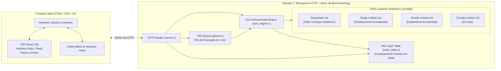

# Plano de Arquitetura e Implementação — Plataforma de Análise de Estruturas e Algoritmos (Ordena)

Este documento detalha o diagnóstico do estado atual do projeto e o plano completo de engenharia para atender a todos os requisitos da Avaliação Final descritos no PDF da disciplina, incorporando suas definições de arquitetura.

---

## 1. Diagnóstico do Estado Atual vs. Requisitos do Projeto

| Requisito (PDF + Definições) | Estado Atual no Repositório | O que precisa ser feito (Gap Analysis) |
| :--- | :--- | :--- |
| **Alocação Dinâmica e Ponteiros** (`malloc`, `realloc`, `free`) + Monitoramento de Tempo e Memória | `src/sort_engine.c` ainda usa vetores estáticos globais (`values[MAX_ITEMS]`, `merge_buffer[MAX_ITEMS]`) e `src/server.c` usa `values[API_MAX_INPUT]`. `Metrics` monitora apenas tempo, comparações e trocas (sem consumo de memória). | Substituir todos os buffers estáticos por alocação 100% dinâmica (`malloc`/`realloc`/`free`), unificar o histórico de operações com o TAD de Lista Sequencial e instrumentar o cálculo de memória alocada (`memoryBytes` / pico e consumo da estrutura + auxiliar). |
| **Listas Lineares (Simplesmente Encadeada, Duplamente Encadeada e Circular)** | Existe apenas `listaSequencial` em `src/tad/`, usada apenas na serialização do JSON em `server.c`. Os 5 algoritmos ordenam apenas o array estático `values[]`. | Criar os TADs dinâmicos para **Singly Linked List**, **Doubly Linked List** e **Circular Linked List** seguindo o padrão de tipos opacos (`typedef struct ...`) do código base enviado. Implementar os 5 algoritmos (Bubble, Selection, Insertion, Quick, Merge) manipulando ponteiros/nós em cada estrutura para comparar o desempenho com o vetor contíguo dinâmico (`Sequential List`). |
| **Pilha (Undo / Passo a Passo no JS)** | `web/app.js` usa um array simples de `animationFrames` indexado por `currentFrameIndex`. | Implementar a estrutura de dados **Stack (Pilha)** no JavaScript (`UndoStack` / `RedoStack`) para gerenciar o histórico de operações no modo passo a passo (*Step Back / Undo* e *Step Forward / Redo*) sobre o estado visualizado. |
| **Fila (Batch Processing no C)** | Não existe execução em lote. A API possui apenas `GET /api/sort` para uma única execução. | Criar o TAD dinâmico **Queue (Fila)** em C (`malloc`/`free` com nós encadeados) para enfileirar múltiplos cenários de teste (diferentes estruturas, tamanhos e algoritmos) e processá-los em lote via novo endpoint (`POST /api/batch` ou `GET /api/batch`), retornando o relatório comparativo de desempenho. |
| **Tabela Hash (Extra — Histórico em C)** | Não existe armazenamento de testes anteriores; cada chamada a `sort_run` sobrescreve e libera os dados ao final da requisição. | Criar o TAD dinâmico **Hash Table** em C com **encadeamento exterior** (*Separate Chaining*: array dinâmico de buckets alocado com `malloc`/`realloc` apontando para listas encadeadas dinâmicas) indexado pelo nome do algoritmo (`algorithmName`), mantendo em memória (RAM) todos os testes executados e seus históricos completos para consulta rápida. |
| **Padronização em Inglês + `AI_LOG.md`** | Código misto: `sort_engine.c` em inglês, `listaSequencial.c`, `server.c` (mensagens), `index.html` e `README.md` em português. `AI_LOG.md` ainda não existe. | Padronizar 100% dos identificadores (incluindo TADs), comentários de código e `README.md` em inglês. Criar e manter o arquivo `AI_LOG.md` documentando prompts e adaptações. |

---

## 2. Arquitetura do Sistema e Organização de Diretórios



### Estrutura de Arquivos Proposta (`src/`)

Seguindo o padrão de separação entre `headerFiles` e `sourceFiles` já presente em `src/tad/` e totalmente padronizado em inglês:

```text
src/
├── server.c                              # Servidor HTTP Mongoose e rotas REST JSON
├── sort_engine.h                         # Interface pública do motor de ordenação e métricas
├── sort_engine.c                         # Implementação dos 5 algoritmos para Vetor e Listas + métricas de memória/tempo
└── tad/
    ├── headerFiles/
    │   ├── sequential_list.h             # (Antigo listaSequencial.h) Vetor dinâmico com malloc/realloc/free
    │   ├── singly_linked_list.h          # Lista Simplesmente Encadeada dinâmica (baseada no lista.h enviado)
    │   ├── doubly_linked_list.h          # Lista Duplamente Encadeada dinâmica
    │   ├── circular_linked_list.h        # Lista Circular dinâmica
    │   ├── queue.h                       # Fila dinâmica para Batch Processing de testes
    │   └── hash_table.h                  # Tabela Hash dinâmica (Encadeamento Exterior) para histórico de testes
    └── sourceFiles/
        ├── sequential_list.c
        ├── singly_linked_list.c
        ├── doubly_linked_list.c
        ├── circular_linked_list.c
        ├── queue.c
        └── hash_table.c
```

---

## 3. Especificação Detalhada dos TADs (Padrão da Disciplina + Alocação Dinâmica)

Todos os TADs seguirão o estilo dos arquivos base enviados (`lista.h`/`lista.c` e `tabela_hash.c`): structs encapsuladas no `.c` com `typedef struct ...` no `.h` (tipos opacos), verificação rigorosa de `NULL` e uso explícito de `malloc`, `realloc` e `free`.

### 3.1. `sequential_list` (Vetor Contíguo Dinâmico)
- Refatoração de `listaSequencial.c` / `.h` para inglês (`SequentialList`).
- Mantém `void *elements`, `int size`, `int capacity`, `size_t element_size`.
- Funções: `seq_list_create`, `seq_list_insert_end`, `seq_list_insert_start`, `seq_list_remove_at`, `seq_list_get`, `seq_list_set`, `seq_list_size`, `seq_list_memory_usage`, `seq_list_destroy`.
- Usado tanto como estrutura de dados contígua a ser ordenada quanto para armazenar o array dinâmico de `Operation` durante a execução do algoritmo.

### 3.2. `singly_linked_list`, `doubly_linked_list` e `circular_linked_list`
- Baseados diretamente na estrutura `No` / `Lista` de `lista.c` enviada:
  - **Singly Linked List**: `SinglyNode { int32_t data; struct SinglyNode *next; }`, com controle de `head`, `tail`, `size` e `memory_bytes`.
  - **Doubly Linked List**: `DoublyNode { int32_t data; struct DoublyNode *prev; struct DoublyNode *next; }`, com `head`, `tail`, `size` e `memory_bytes`.
  - **Circular Linked List**: `CircularNode { int32_t data; struct CircularNode *next; }`, onde `tail->next == head`, com `head`, `tail`, `size` e `memory_bytes`.
- **Ordenação por manipulação de ponteiros**:
  - Os 5 algoritmos (`Bubble Sort`, `Selection Sort`, `Insertion Sort`, `Quick Sort`, `Merge Sort`) serão implementados operando sobre os nós das listas e reencadeando ponteiros (`next`/`prev`) — especialmente no *Insertion Sort* (remoção e reinserção de nó na sublista ordenada por ponteiros) e *Merge Sort* (divisão por ponteiro *slow/fast* e fusão religando ponteiros sem vetor auxiliar), emitindo os eventos `Operation` correspondentes para que o visualizador também possa animar e comparar com o vetor contíguo.

### 3.3. `queue` (Fila Dinâmica em C para Batch Processing)
- Implementada com alocação dinâmica encadeada (`QueueNode` com `malloc`/`free`, ponteiros `front` e `rear`, contador `size`).
- Cada item da fila (`BatchTask`) armazena:
  - `int algorithm` (0..4)
  - `int structure_type` (`STRUCT_SEQUENTIAL`, `STRUCT_SINGLY`, `STRUCT_DOUBLY`, `STRUCT_CIRCULAR`)
  - `int32_t *input_values` (alocado dinamicamente com `malloc`)
  - `int item_count`
- Operações do TAD:
  - `Queue *queue_create(void)`
  - `int queue_enqueue(Queue *queue, const BatchTask *task)`
  - `int queue_dequeue(Queue *queue, BatchTask *out_task)`
  - `int queue_is_empty(const Queue *queue)`
  - `int queue_size(const Queue *queue)`
  - `void queue_destroy(Queue *queue)`

### 3.4. `hash_table` (Tabela Hash Dinâmica com Encadeamento Exterior em C)
- Segue a organização modular de `tabela_hash.c` combinada com a lista encadeada dinâmica de `lista.c`:
  - A estrutura `HashTable` possui um vetor dinâmico de ponteiros de buckets (`HashNode **buckets`) alocado via `malloc` e redimensionável via `realloc` (`hash_table_resize` quando o fator de carga $\alpha = \text{count} / M > 0.75$).
  - Função de espalhamento (*hash function*) sobre string (`const char *algorithm_name`), ex.: polinomial / DJB2 módulo `M` (`index = hash_function(key) % table->bucket_count`), mantendo também compatibilidade conceitual com o operador `% M`.
  - **Tratamento de colisões por Encadeamento Exterior (Separate Chaining)**: cada posição `buckets[index]` aponta para uma lista encadeada de `HashNode`.
  - Cada `HashNode` armazena um `TestReport` alocado dinamicamente:
    - `uint64_t test_id` (identificador único sequencial)
    - `char *algorithm_name` (chave indexada, ex.: `"Bubble Sort"`, `"Merge Sort"`)
    - `int algorithm_id` e `int structure_type` (`Sequential`, `Singly`, `Doubly`, `Circular`)
    - `Metrics metrics` (incluindo `comparisons`, `swaps`, `elapsed_ms`, `memory_bytes`, `operation_count`)
    - `int32_t *input_values` e `int32_t *sorted_values` (alocados dinamicamente)
    - `Operation *operations` (ou `SequentialList *operations` com o histórico completo de passos daquele teste)
- Operações do TAD:
  - `HashTable *hash_table_create(size_t initial_bucket_count)`
  - `int hash_table_insert(HashTable *table, const char *algorithm_name, const TestReport *report)`
  - `SequentialList *hash_table_search_by_algorithm(HashTable *table, const char *algorithm_name)` (recupera todos os relatórios daquele algoritmo percorrendo a lista encadeada do bucket correspondente)
  - `const TestReport *hash_table_get_by_id(HashTable *table, uint64_t test_id)` (recupera um teste específico com seu array completo de `operations` para re-reproduzir na tela)
  - `void hash_table_destroy(HashTable *table)` (libera todos os arrays internos, nós encadeados, vetores de buckets e a estrutura principal com `free`)

### 3.5. `OperationStack` (Pilha Dinâmica no JavaScript para Undo / Passo a Passo)
- No arquivo `web/app.js`, criação da classe/TAD `Stack`:
  - Métodos clássicos de TAD: `push(element)`, `pop()`, `peek()`, `isEmpty()`, `size()`, `clear()`.
- **Integração com o modo passo a passo**:
  - Duas instâncias: `undoStack` (pilha de operações aplicadas) e `redoStack` (pilha de operações desfeitas).
  - Em vez de depender apenas de snapshots pré-copiados de todo o vetor em cada passo, cada operação executada (`COMPARE`, `SWAP`, `WRITE`) empilha na `undoStack` um registro reversível contendo os valores anteriores (`prevFirstValue`, `prevSecondValue`, métricas anteriores).
  - Quando o usuário clica em **Voltar um passo (Undo / `‹`)**, o sistema faz `undoStack.pop()`, reverte cirurgicamente a alteração no array `displayedValues`, restaura as métricas daquele ponto e empilha a operação em `redoStack`.
  - Quando avança um passo (`›`), desempilha de `redoStack` (ou consome a próxima operação) e empilha em `undoStack`.

---

## 4. Novas Métricas e Endpoints da API HTTP (`src/server.c`)

### 4.1. Monitoramento de Tempo e Memória (`Metrics`)
A struct `Metrics` em `src/sort_engine.h` será expandida para:
```c
typedef struct {
  int32_t algorithm;
  int32_t structure_type;
  int32_t item_count;
  int64_t comparisons;
  int64_t swaps;
  double elapsed_ms;
  size_t memory_bytes;      /* Memória dinâmica alocada pela estrutura + buffers auxiliares */
  int32_t operation_count;
} Metrics;
```
- **Cálculo de Memória (`memory_bytes`)**:
  - **Sequential List (Vetor Dinâmico)**: `sizeof(SequentialList) + capacity * sizeof(int32_t)` (+ buffer auxiliar dinâmico no Merge Sort).
  - **Singly Linked List**: `sizeof(SinglyLinkedList) + item_count * sizeof(SinglyNode)`.
  - **Doubly Linked List**: `sizeof(DoublyLinkedList) + item_count * sizeof(DoublyNode)`.
  - **Circular Linked List**: `sizeof(CircularLinkedList) + item_count * sizeof(CircularNode)`.
  - Isso permitirá visualizar claramente na interface a diferença de overhead de memória entre vetores contíguos e listas encadeadas (ponteiros extras por nó vs. realocação de capacidade).

### 4.2. Rotas HTTP (JSON)
1. **`GET /api/sort?algorithm=<0..4>&structure=<0..3>&values=<csv>`**
   - Executa a ordenação na estrutura escolhida (`0` Sequential Array, `1` Singly Linked List, `2` Doubly Linked List, `3` Circular Linked List).
   - Salva automaticamente o relatório completo e seu histórico na **Tabela Hash** em memória.
   - Retorna o JSON com `testId`, `algorithm`, `algorithmName`, `structure`, `structureName`, `input`, `sorted`, `metrics` (incluindo `memoryBytes`) e `operations`.
2. **`POST /api/batch` (ou `GET /api/batch?algorithms=...&structures=...&values=...`)**
   - Recebe uma lista de tarefas de teste, insere cada uma na **Fila (`Queue`)** em C, consome a fila até esvaziar (`queue_dequeue`) executando cada benchmark, registra todos os resultados na **Tabela Hash** e retorna um JSON comparativo com as métricas de todas as execuções do lote.
3. **`GET /api/history?algorithm=<algorithmName>`**
   - Consulta a **Tabela Hash** em C pelo nome do algoritmo (ou lista todos se omitido), retornando os relatórios de testes anteriores indexados na tabela (com `testId`, estrutura utilizada, tamanho da entrada, comparações, trocas, tempo em ms e memória em bytes).
4. **`GET /api/history/detail?id=<testId>`**
   - Recupera da **Tabela Hash** o histórico completo (`operations`, `input`, `sorted`, `metrics`) de um teste anterior específico para recarregá-lo e animá-lo novamente na interface web.

---

## 5. Evoluções na Interface Web (`index.html`, `web/app.js`, `web/style.css`)

1. **Seletor de Estrutura de Dados**:
   - Adicionar ao painel lateral (`aside.controls`) a seleção da estrutura linear:
     - `Dynamic Contiguous Array (Sequential List)`
     - `Singly Linked List`
     - `Doubly Linked List`
     - `Circular Linked List`
2. **Card de Métrica de Consumo de Memória**:
   - Adicionar nos cards de métricas (`div.metrics`) o indicador **MEMORY USAGE** (em `bytes` / `KB`), exibindo o consumo dinâmico reportado pelo C.
3. **Controle Passo a Passo com Pilha (Undo/Redo)**:
   - Refatorar o player em `web/app.js` para operar sobre o TAD `Stack` em JavaScript, exibindo o topo da pilha e o tamanho da pilha de Undo/Redo no rótulo de passo.
4. **Seção de Execução em Lote (Batch Processing — Fila) e Histórico (Tabela Hash)**:
   - Adicionar abaixo do gráfico principal (ou em abas/painéis inferiores):
     - **Batch Benchmark (Queue)**: botão para enfileirar e comparar os algoritmos/estruturas (ex.: comparar Vetor vs. Listas Encadeadas para a mesma entrada) exibindo uma tabela comparativa de Tempo, Comparações, Trocas/Ponteiros e Memória.
     - **Previous Tests History (Hash Table Lookup)**: filtro de busca pelo nome do algoritmo que consulta `/api/history?algorithm=...` na Tabela Hash em C, lista os testes passados e permite clicar em **"Replay"** para carregar aquele teste de volta no visualizador.

---

## 6. Fases de Execução Passo a Passo

### Fase 1: Refatoração e Criação dos TADs Lineares Dinâmicos em C (`src/tad/`)
1. Renomear e padronizar `listaSequencial` para `sequential_list.h` / `sequential_list.c` em inglês.
2. Implementar `singly_linked_list.h/.c`, `doubly_linked_list.h/.c` e `circular_linked_list.h/.c` usando `malloc`/`free` e tipos opacos.
3. Implementar os 5 algoritmos de ordenação manipulando nós/ponteiros para as 3 listas encadeadas e para a lista sequencial dinâmica.

### Fase 2: TADs de Fila (Batch) e Tabela Hash (Encadeamento Exterior) em C (`src/tad/`)
1. Implementar `queue.h/.c` com alocação dinâmica para armazenar e processar lotes de `BatchTask`.
2. Implementar `hash_table.h/.c` com vetor dinâmico de buckets (`malloc`/`realloc`) e listas encadeadas para colisões (encadeamento exterior), indexando relatórios de teste (`TestReport`) pelo nome do algoritmo.

### Fase 3: Motor de Ordenação e Rotas do Servidor (`src/sort_engine.*`, `src/server.c`)
1. Remover todos os arrays estáticos (`values[MAX_ITEMS]`, `merge_buffer[MAX_ITEMS]`, `values[API_MAX_INPUT]`) substituindo por alocação dinâmica (`malloc`/`realloc`/`free`).
2. Adicionar rastreamento preciso de `memory_bytes` em `Metrics`.
3. Integrar `HashTable` global no ciclo de vida do servidor (`server.c`) para salvar automaticamente cada execução e expor `/api/history` e `/api/history/detail`.
4. Integrar `Queue` na nova rota `/api/batch`.

### Fase 4: Frontend Web + Pilha de Undo em JavaScript (`index.html`, `web/app.js`, `web/style.css`)
1. Implementar a classe TAD `Stack` em `web/app.js` e conectá-la aos controles de passo a passo (`Undo` / `Redo`) e timeline.
2. Atualizar a UI com seletor de Estrutura Linear, métrica de Memória, painel de Batch Processing (Fila) e painel de Histórico de Testes (busca na Tabela Hash com Replay).
3. Padronizar textos/comentários e código em inglês.

### Fase 5: Documentação Final e Integridade Acadêmica (`README.md`, `AI_LOG.md`)
1. Reescrever o `README.md` em inglês documentando a arquitetura, estruturas de dados, complexidades, endpoints da API e instruções de build/execução.
2. Criar o arquivo `AI_LOG.md` registrando os prompts utilizados e explicando as adaptações para os padrões de TADs da disciplina.
3. Compilar com `make rebuild` (`-Wall -Wextra`) garantindo zero warnings e testar todas as funcionalidades.
